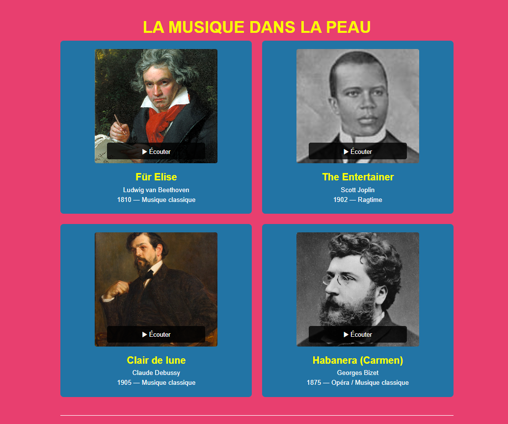
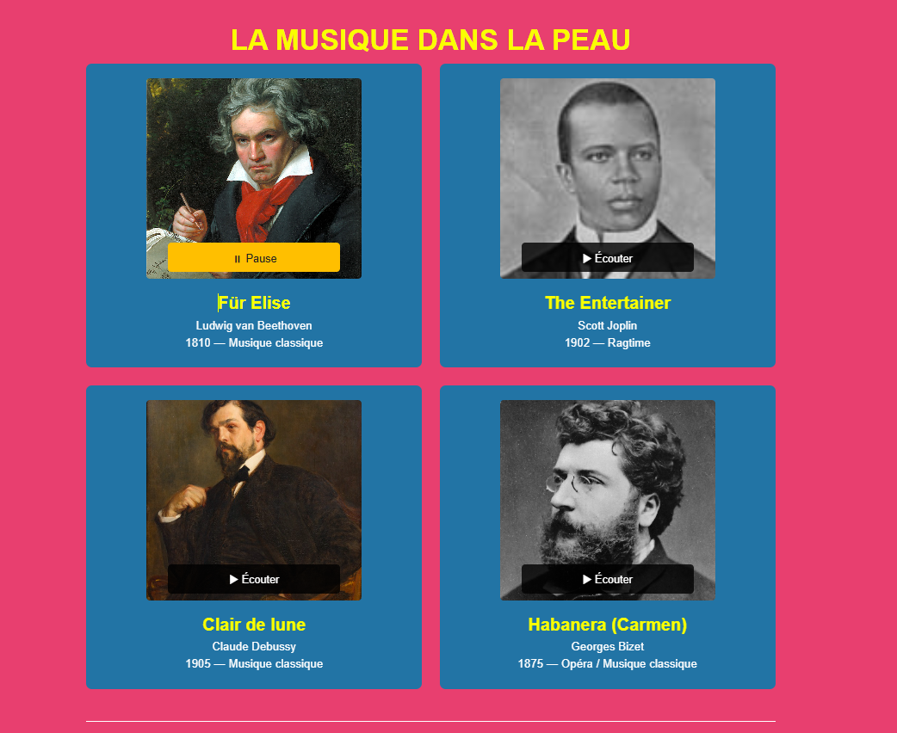

# Songs List 

I originally created this project during one of my first web development classes. The goal was to practice building a responsive webpage using CSS Grid, while learning how to organize and display information with PHP.

I later revisited the project to correct some issues, improve the layout, and make the music player easier to use while keeping the original idea and structure.

## Features

- Displays four well-known musical compositions with their titles, composers, dates, and genres.
- Generates the music cards dynamically from a PHP array.
- Uses a responsive CSS Grid layout with two columns on desktop and one on smaller screens.
- Allows visitors to play and pause music directly from each card.
- Stops the previous recording when another one starts playing.
- Displays a loading message when audio playback takes time to start.
- Includes music credits and licensing information.

## Technologies Used

| Technology | Purpose |
|---|---|
| PHP | Stores the music information and generates the HTML cards |
| HTML | Structures the webpage |
| CSS | Styles the gallery and adapts it to different screen sizes |
| JavaScript | Handles audio playback and user interactions |

The project doesn't require a database, external framework, or third-party JavaScript libraries.

## Screenshots

### Music Gallery



### Music Playback



## Project Structure

```text
songs-list/
├── index.php
├── singles.php
├── styles.css
├── script.js
├── README.md
├── .gitignore
├── audio/
│   ├── fur-elise.ogg
│   ├── the-entertainer.mp3
│   ├── clair-de-lune.ogg
│   └── habanera.ogg
├── images/
│   ├── beethoven.jpg
│   ├── scott-joplin.jpeg
│   ├── debussy.jpg
│   └── bizet.jpg
└── screenshots/
    ├── gallery.png
    └── playback.png
```

## How to Run the Project

### Requirements

- PHP installed on your computer
- A web browser

No additional dependencies are required.

### 1. Download the project

Clone the repository:

```bash
git clone https://github.com/maellemd/songs-list.git
cd songs-list
```

Alternatively, download the ZIP file from GitHub and extract it.

### 2. Start the PHP development server

Open a terminal in the project directory and run:

```bash
php -S localhost:8000
```

### 3. Open the application

Visit:

`http://localhost:8000/index.php`

You can now browse the music gallery and use the play/pause buttons to listen to the recordings.

Stop the server by pressing `Ctrl + C` in the terminal.

## How the Project Works

The application is built around two PHP files.

**`singles.php`** contains an array holding the information for each musical work, including its title, composer, year, genre, image, and audio file.

**`index.php`** loads that array and uses a `foreach` loop to generate an HTML card for each entry.

**`styles.css`** controls the appearance of the cards, the colors, and the responsive grid layout.

**`script.js`** listens for clicks on the play/pause buttons and controls the HTML audio elements. It also makes sure that only one recording plays at a time.

This structure keeps the project small while separating the music data, page presentation, styling, and interactivity.

## Improvements Made

When revisiting this project, I made several changes to improve its functionality and readability:

- Corrected the original HTML structure.
- Fixed the CSS Grid layout.
- Reduced the gallery to four selected musical works.
- Replaced hover-triggered playback with clearly visible play/pause buttons.
- Added loading feedback and basic audio error handling.
- Improved keyboard accessibility for the audio controls.
- Used `htmlspecialchars()` when displaying values from the PHP array.
- Improved the responsive layout while preserving the original colors.
- Replaced the original commercial recordings with recordings distributed under licences permitting reuse.

These changes helped me revisit fundamental web development concepts and apply practices I learned after completing the original classroom exercise.

## Music and Image Credits

The project features four compositions whose original musical works are in the public domain.

The specific sound recordings are used under their respective licences.

| Composition | Recording | Licence |
|---|---|---|
| Für Elise — Ludwig van Beethoven | V. Gao | CC0 |
| The Entertainer — Scott Joplin | James Brigham | CC0 |
| Clair de lune — Claude Debussy | Laurens Goedhart | CC BY 3.0 |
| Habanera — Georges Bizet | Kevin MacLeod arrangement | CC BY 3.0 |

### Recording Sources

- [Für Elise — Wikimedia Commons](https://commons.wikimedia.org/wiki/File:FurElise.ogg)
- [The Entertainer — Wikimedia Commons](https://commons.wikimedia.org/wiki/File:%22The_Entertainer%22_(1902),_by_Scott_Joplin.mp3)
- [Clair de lune — Wikimedia Commons](https://commons.wikimedia.org/wiki/File:Clair_de_lune_(Claude_Debussy)_Suite_bergamasque.ogg)
- [Habanera — Wikimedia Commons](https://commons.wikimedia.org/wiki/File:Kevin_MacLeod_-_Georges_Bizet_Habanera.ogg)

Recordings under CC BY 3.0 are attributed to their respective performers or arrangers.

The composer portraits come from Wikimedia Commons and are used according to the licensing information on their individual file pages.

The project's code and the included third-party media have separate copyright considerations. Reusing the code does not automatically grant additional rights over the recordings or images.

## What I Practiced

This project gave me an opportunity to practice:

- Structuring webpages with HTML.
- Creating responsive layouts using CSS Grid.
- Working with arrays and loops in PHP.
- Generating HTML dynamically.
- Using JavaScript event listeners.
- Controlling HTML audio elements.
- Organizing project files.
- Debugging and improving an existing application.
- Understanding why licensing matters when publishing web projects.

## Possible Future Improvements
The project is intentionally small, but possible additions include:

- Filtering music by genre.
- Searching for a composition by title or composer.
- Displaying playback progress.
- Adding more public-domain compositions with appropriately licensed recordings.

The current version focuses on the original learning objectives rather than adding unnecessary features.